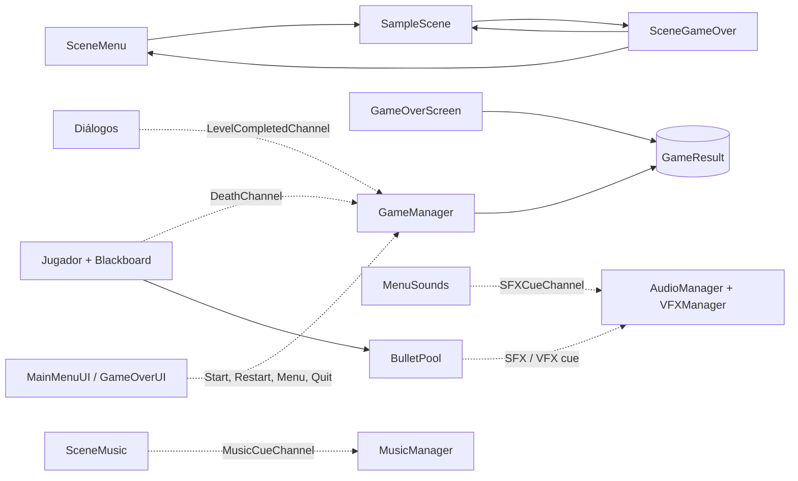

<!-- Mapa del juego. Al día con el ciclo 04 y la revisión del 2026-11-20. Leído del código de Assets/Scripts. -->
# Arquitectura de The Slime's Warden

## Un frame, en orden
1. Update: `PlayerInput` lee las acciones y rellena `PlayerBlackboard` (`moveInput`, `shootIntent`); con `IsControlLocked` (hablando o muerto) lo anula. `PlayerCombat` dispara pidiendo una bala a `BulletPool`. `DialogueUI`, `SelectionKeeper`, `MenuSounds`, `SlimeCompanion` y `AudioManager` hacen su parte.
2. FixedUpdate: `PlayerMovement` aplica `Rigidbody2D.velocity` leyendo el blackboard; `GroundDetector`, `EnemyPatrol` y `EnemyShooter` consultan la física. El orden entre `GroundDetector` y `PlayerMovement` no está fijado: tras saltar o rebotar, `groundIgnoreTimer` (0,1 s) hace que el resultado no dependa de él, y un trampolín no cuenta como suelo mientras el Brujo cae sobre él.
3. Física: `Bullet` choca, aplica `IDamageable.TakeDamage`, lanza cues de audio y VFX por canal y vuelve a su pool.
4. Cinemachine mueve la cámara y dispara `CameraUpdatedEvent`: `BackgroundZones` y `ZoneParallaxLayer` se actualizan ahí.

## Sistemas y conexiones

- Los managers (`GameManager`, `AudioManager`, `MusicManager`) nacen en SceneMenu y usan DontDestroyOnLoad; `VFXManager` existe por escena.

## Sistemas
| Sistema | Archivos (Assets/Scripts) | Responsabilidad | Depende de | Lo usan |
|---|---|---|---|---|
| Jugador | Player/ `PlayerInput`, `PlayerBlackboard`, `PlayerMovement`, `PlayerCombat`, `PlayerHealth`, `PlayerVisuals`, `PlayerFootsteps`, `GroundDetector`, `PlayerDialogueListener` | Input → blackboard → física; vida y muerte | canales, `BulletPool` | Squishy, UI |
| Squishy | Slime/ `SlimeCompanion` | Flota a los pies del Brujo | Transform del jugador | - |
| Enemigos y plataformas | Enemy/ `EnemyPatrol`, `EnemyShooter`; Systems/ `HealthSystem`; Platforms/ `FragilePlatform`, `Trampoline` | Patrullar, disparar, recibir daño | `BulletPool`, `IDamageable` | `Bullet` |
| Balas (pool) | Bullet/ `Bullet`, `BulletPool`, `CollectibleAmmo`; Interfaces/ `IDamageable` | Pool con `UnityEngine.Pool` | canales SFX/VFX | jugador, enemigos |
| Audio | Audio/ `AudioManager`, `PooledAudio`, `MusicManager`, `SceneMusic`, `AudioCue`, canales | SFX con pool; música con crossfade | cues y canales | casi todos |
| VFX | VFX/ `VFXManager`, `PooledVFX`, `VFXCueChannel` | Efectos con pool por tipo | canal VFX | `Bullet` |
| Diálogos | Dialogue/ `LevelIntroDialogue`, `OutroDialogueTrigger`; UI/ `DialogueUI`; ScriptableObjects/ `DialogueData` | Mostrar diálogos y avisar del fin | canales de diálogo | jugador |
| Fondo por zonas | Background/ `BackgroundZones`, `ZoneParallaxLayer` | Color y pilares por zona | Cinemachine | - |
| UI | UI/ `MainMenuUI`, `GameOverUI`, `GameOverScreen`, `SelectionKeeper`, `MenuSounds`, `LifeUI`, `MenuButtonFeedback`, `UIFloat` | Menú, pantalla final, vidas; `MenuSounds` (Canvas de SceneMenu y SceneGameOver, junto a `SelectionKeeper`) escucha la selección del EventSystem y los `onClick` | canales, `GameResult`, `SFXCueChannel` | - |
| GameManager | Managers/ `GameManager` | Único que carga escenas; anota el resultado | canales, `GameResult` | todos por canal |
| Diagnóstico | Diagnostics/ `FrameTimeRecorder` | Solo con `--measure` en el juego exportado: pulsa Jugar, mide 30 s y cierra | `MainMenuUI` | comando «Medir» |

## Datos y valores de ajuste
- Canales (.asset en la raíz de Assets): `VoidEventChannel` (DeathChannel, LevelCompletedChannel, Event_*, DialogueEndedChannel), `IntEventChannel` (PlayerHealthChannel), `DialogueEventChannel`, `AudioCueChannel` (SFXCueChannel), `MusicCueChannel`, `VFXCueChannel`.
- Datos compartidos: `GameResult` (`GameOutcome` Defeat o Victory; `[NonSerialized]`, vuelve a Defeat al recargar scripts).
- Audio: `Cue_UI_Move` y `Cue_UI_Press` (Assets/Audio) salen por el grupo UI del `MasterMixer`. Los grupos del mixer están a 0 dB: la mezcla de volúmenes vive en el `volumeRange` de cada `AudioCue`.
- Ajuste por Inspector: `PlayerBlackboard`, `GameOverScreen`, `BackgroundZones`, `SlimeCompanion`, cues de audio, `MenuSounds` (canal y 2 cues).

## Ensamblados y pruebas
- `Assets/Scripts/SlimesWarden.asmdef`: todo el juego; referencia Cinemachine, Unity.InputSystem, Unity.TextMeshPro y UnityEngine.UI.
- `Assets/Tests/EditMode/SlimesWarden.Tests.EditMode.asmdef` (solo Editor): `GameResultTests`, `GameOverScreenTests`, `MenuSoundsTests`, `FrameTimeRecorderTests`, `PlayerJumpTests` (30 pruebas).

## Para cambiar X, toca Y
- Un fin nuevo: `GameOutcome` en `GameResult.cs`, un `Variant` en `GameOverScreen.cs`, un canal en `GameManager.cs`.
- Un sonido nuevo: crear un `AudioCue` y lanzarlo por `SFXCueChannel` (sin tocar `AudioManager`).
- Un efecto nuevo: añadir a `VFXType` y a la lista del `VFXManager`.
- Un bloqueo del jugador: `PlayerBlackboard.IsControlLocked`.
- Una pantalla con botones: `SelectionKeeper` y `MenuSounds` en el Canvas y First Selected en el EventSystem.

## Patrones en uso
- Canales de eventos ScriptableObject (Observer): desde el inicio; también `MenuSounds` (ciclo 04).
- Blackboard: jugador, desde el inicio.
- Pooling: balas, audio y VFX (`UnityEngine.Pool`), desde el inicio.
- Data as Asset: `GameResult`, ciclo 03.
- Instancia única + DontDestroyOnLoad: managers; el sonido del botón no se corta al cambiar de escena.
- Double Buffering: `MusicManager`, para el crossfade.
- Regla pura estática probada sin escena: `GameOverScreen.OutcomeToShow` (ciclo 03), `MenuSounds.ShouldPlayMove` (ciclo 04), `PlayerMovement.CanJump` y `GroundDetector.CountsAsGround`/`IsSolidGround` (revisión 2026-11-20).

## Listo para crecer
- Más finales: un valor de `GameOutcome` y una `Variant`.
- Más pruebas: reglas puras (vidas, daño) en `Assets/Tests/EditMode`.
- Más sonido: nuevos cues sin tocar código.

## Deuda conocida
- Managers solo en SceneMenu: Play directo en otra escena no tiene carga, muerte ni música.
- 32 texturas sin comprimir; `onClick` del menú con `Assembly-CSharp`.
- GDD desfasado; falta `docs/motor.md`. Una frágil rota no vuelve (posible atasco, H2 de la revisión 2026-11-20).
- `MenuSounds` toma los botones en `Awake` (no engancha los creados después).
