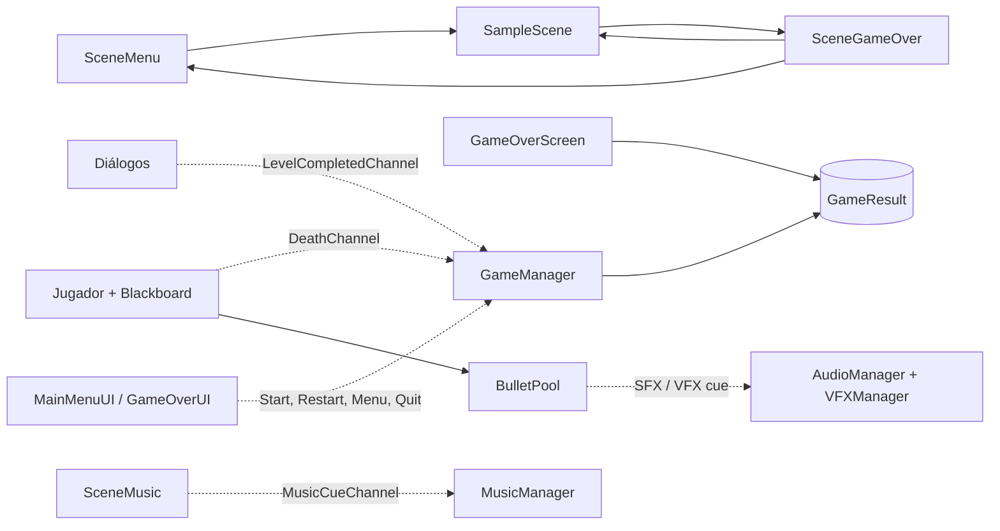

<!-- Mapa del juego. Al día con el ciclo 03. Leído del código de Assets/Scripts. -->
# Arquitectura de The Slime's Warden

## Un frame, en orden
1. Update: `PlayerInput` lee las acciones y rellena `PlayerBlackboard` (`moveInput`, `shootIntent`); con `IsControlLocked` (hablando o muerto) lo anula. `PlayerCombat` dispara pidiendo una bala a `BulletPool`. `DialogueUI`, `SelectionKeeper`, `SlimeCompanion` y `AudioManager` hacen su parte.
2. FixedUpdate: `PlayerMovement` aplica `Rigidbody2D.velocity` leyendo el blackboard; `GroundDetector`, `EnemyPatrol` y `EnemyShooter` consultan la física.
3. Física: `Bullet` choca, aplica `IDamageable.TakeDamage`, lanza cues de audio y VFX por canal y vuelve a su pool.
4. Cinemachine mueve la cámara y dispara `CameraUpdatedEvent`: `BackgroundZones` y `ZoneParallaxLayer` se actualizan ahí.

## Sistemas y conexiones

- Los managers (`GameManager`, `AudioManager`, `MusicManager`) nacen en SceneMenu y usan DontDestroyOnLoad; `VFXManager` existe por escena.

## Sistemas
| Sistema | Archivos (Assets/Scripts) | Responsabilidad | Depende de | Lo usan |
|---|---|---|---|---|
| Jugador | Player/ `PlayerInput`, `PlayerBlackboard`, `PlayerMovement`, `PlayerCombat`, `PlayerHealth`, `PlayerVisuals`, `PlayerFootsteps`, `GroundDetector`, `PlayerDialogueListener` | Input → blackboard → física; vida y muerte | canales, `BulletPool` | Squishy, UI |
| Squishy | Slime/ `SlimeCompanion` (en uso), `PetFollower` (sin uso: ninguna escena ni prefab lo lleva) | Flota a los pies del Brujo | Transform del jugador | - |
| Enemigos y plataformas | Enemy/ `EnemyPatrol`, `EnemyShooter`; Systems/ `HealthSystem` (vida de los prefabs SlimeBlue y SlimeOrange); Platforms/ `FragilePlatform`, `Trampoline` | Patrullar, disparar, recibir daño | `IBulletPool`, `IDamageable` | `Bullet` |
| Balas (pool) | Bullet/ `Bullet`, `BulletPool`, `CollectibleAmmo`; Interfaces/ `IBulletPool`, `IDamageable` | Pool con `UnityEngine.Pool` | canales SFX/VFX | jugador, enemigos |
| Audio | Audio/ `AudioManager`, `PooledAudio`, `MusicManager`, `SceneMusic`, `AudioCue`, `AudioSettingsSO`, `AudioSettingsBinder`, canales | SFX con pool; música con crossfade | cues y canales | casi todos |
| VFX | VFX/ `VFXManager`, `PooledVFX`, `VFXCueChannel` | Efectos con pool por tipo | canal VFX | `Bullet` |
| Diálogos | Dialogue/ `LevelIntroDialogue`, `OutroDialogueTrigger`; UI/ `DialogueUI`; ScriptableObjects/ `DialogueData` | Mostrar diálogos y avisar del fin | canales de diálogo | jugador |
| Fondo por zonas | Background/ `BackgroundZones`, `ZoneParallaxLayer` | Color y pilares por zona | Cinemachine | - |
| UI | UI/ `MainMenuUI`, `GameOverUI`, `GameOverScreen`, `SelectionKeeper`, `LifeUI`, `MenuButtonFeedback`, `UIFloat` | Menú, pantalla final, vidas | canales, `GameResult` | - |
| GameManager | Managers/ `GameManager` | Único que carga escenas; anota el resultado | canales, `GameResult` | todos por canal |

## Datos y valores de ajuste
- Canales (.asset en la raíz de Assets): `VoidEventChannel` (DeathChannel, LevelCompletedChannel, Event_StartGame, Event_RestartGame, Event_ReturnToMenu, Event_QuitGame, DialogueEndedChannel), `IntEventChannel` (PlayerHealthChannel), `DialogueEventChannel`, `AudioCueChannel`, `MusicCueChannel`, `VFXCueChannel`.
- Datos compartidos: `GameResult` (`GameOutcome` Defeat o Victory; `[NonSerialized]`, vuelve a Defeat al recargar scripts).
- Ajuste por Inspector: `PlayerBlackboard` (tiempos de salto, vidas), `GameOverScreen` (variantes), `BackgroundZones` (zonas, margen, fundido), `SlimeCompanion` (offsets y suavizado), cues de audio.

## Ensamblados y pruebas
- `Assets/Scripts/SlimesWarden.asmdef`: todo el juego; referencia Cinemachine, Unity.InputSystem, Unity.TextMeshPro y UnityEngine.UI.
- `Assets/Tests/EditMode/SlimesWarden.Tests.EditMode.asmdef` (solo Editor): `GameResultTests` y `GameOverScreenTests` (8 pruebas). Se corren en el Test Runner.

## Para cambiar X, toca Y
- Una pantalla o fin nuevo: `GameOutcome` en `GameResult.cs`, un `Variant` en `GameOverScreen.cs`, un canal y su método en `GameManager.cs`.
- Un sonido nuevo: crear un `AudioCue` y lanzarlo por `SFXCueChannel` (sin tocar `AudioManager`).
- Un efecto nuevo: añadir a `VFXType` y a la lista del `VFXManager`.
- Un bloqueo del jugador (cinemática, pausa): `PlayerBlackboard.IsControlLocked`.
- Una pantalla con botones: `SelectionKeeper` en el Canvas y First Selected en el EventSystem.

## Patrones en uso
- Canales de eventos ScriptableObject (Observer): desde el inicio; cada canal limpia sus oyentes al parar el Play.
- Blackboard: jugador, desde el inicio; los sistemas leen datos, no se llaman entre sí.
- Pooling: balas, audio y VFX (`UnityEngine.Pool`), desde el inicio.
- Data as Asset: `GameResult`, ciclo 03; ninguna escena busca a otra.
- Instancia única + DontDestroyOnLoad: managers, desde el inicio; sobreviven a los cambios de escena.
- Double Buffering: `MusicManager`, para el crossfade.

## Listo para crecer
- Más finales: un valor de `GameOutcome` y una `Variant`.
- Más pruebas: reglas puras (vidas, daño) en `Assets/Tests/EditMode`.
- Más sonido: nuevos cues sin tocar código (siguiente ciclo: sonido en botones).

## Deuda conocida
- Managers solo en SceneMenu: Play directo en otra escena no tiene carga, muerte ni música.
- 32 texturas sin comprimir en el nivel.
- `onClick` del menú con `Assembly-CSharp` (los de SceneGameOver usan `SlimesWarden`).
- GDD desfasado respecto al código; faltan `docs/motor.md` y `docs/rendimiento.md`.
- `PetFollower` no se usa: candidato a podar.
