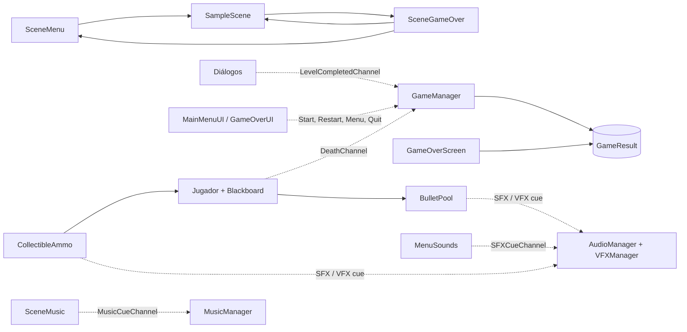

<!-- Mapa del juego. Al día con el ciclo 06. Leído del código de Assets/Scripts. -->
# Arquitectura de The Slime's Warden

## Un frame, en orden
1. Update: `PlayerInput` lee las acciones y rellena `PlayerBlackboard` (`moveInput`, `shootIntent`); con `IsControlLocked` (hablando o muerto) lo anula. `PlayerCombat` dispara pidiendo una bala a `BulletPool`. `DialogueUI`, `SelectionKeeper`, `MenuSounds`, `SlimeCompanion` y `AudioManager` hacen su parte.
2. FixedUpdate: `PlayerMovement` aplica `Rigidbody2D.velocity` leyendo el blackboard; `GroundDetector`, `EnemyPatrol` y `EnemyShooter` consultan la física. El orden entre `GroundDetector` y `PlayerMovement` no está fijado: tras saltar o rebotar, `groundIgnoreTimer` (0,1 s) hace que el resultado no dependa de él, y un trampolín no cuenta como suelo mientras el Brujo cae sobre él.
3. Física: `Bullet` choca, aplica `IDamageable.TakeDamage`, lanza cues de audio y VFX por canal y vuelve a su pool. `CollectibleAmmo.OnTriggerEnter2D` → `TryCollect`: suma munición una vez y lanza destello y sonido por canal.
4. Cinemachine mueve la cámara y dispara `CameraUpdatedEvent`: `BackgroundZones` y `ZoneParallaxLayer` se actualizan ahí.

## Sistemas y conexiones

- Los managers (`GameManager`, `AudioManager`, `MusicManager`) nacen en SceneMenu y usan DontDestroyOnLoad; `VFXManager` existe por escena (su `vfxList` lista los efectos de esa escena).

## Sistemas
| Sistema | Archivos (Assets/Scripts) | Responsabilidad | Depende de | Lo usan |
|---|---|---|---|---|
| Jugador | Player/ `PlayerInput`, `PlayerBlackboard`, `PlayerMovement`, `PlayerCombat`, `PlayerHealth`, `PlayerVisuals`, `PlayerFootsteps`, `GroundDetector`, `PlayerDialogueListener` | Input → blackboard → física; vida y muerte | canales, `BulletPool` | Squishy, UI, `CollectibleAmmo` |
| Squishy | Slime/ `SlimeCompanion` | Flota a los pies del Brujo | Transform del jugador | - |
| Enemigos y plataformas | Enemy/ `EnemyPatrol`, `EnemyShooter`; Systems/ `HealthSystem`; Platforms/ `FragilePlatform`, `Trampoline` | Patrullar, disparar, recibir daño | `BulletPool`, `IDamageable` | `Bullet` |
| Balas y munición (pool) | Bullet/ `Bullet`, `BulletPool`, `CollectibleAmmo`; Interfaces/ `IDamageable` | Pool con `UnityEngine.Pool`; recogida de munición (solo el Brujo, una vez) con destello y sonido | canales SFX/VFX, `PlayerBlackboard` | jugador, enemigos |
| Audio | Audio/ `AudioManager`, `PooledAudio`, `MusicManager`, `SceneMusic`, `AudioCue`, canales | SFX con pool; música con crossfade | cues y canales | casi todos |
| VFX | VFX/ `VFXManager`, `PooledVFX`, `VFXCueChannel` | Efectos con pool por tipo (`VFXType`: PlayerHit, EnemyHit, AmmoPickup) | canal VFX | `Bullet`, `CollectibleAmmo` |
| Diálogos | Dialogue/ `LevelIntroDialogue`, `OutroDialogueTrigger`; UI/ `DialogueUI`; ScriptableObjects/ `DialogueData` | Mostrar diálogos y avisar del fin | canales de diálogo | jugador |
| Fondo por zonas | Background/ `BackgroundZones`, `ZoneParallaxLayer` | Color y pilares por zona | Cinemachine | - |
| UI | UI/ `MainMenuUI`, `GameOverUI`, `GameOverScreen`, `SelectionKeeper`, `MenuSounds`, `LifeUI`, `MenuButtonFeedback`, `UIFloat` | Menú, pantalla final, vidas; `MenuSounds` escucha la selección del EventSystem y los `onClick` | canales, `GameResult`, `SFXCueChannel` | - |
| GameManager | Managers/ `GameManager` | Único que carga escenas; anota el resultado | canales, `GameResult` | todos por canal |
| Diagnóstico | Diagnostics/ `FrameTimeRecorder`, `LevelCapture` | Solo con `--measure` o `--capture` en el exportado: pulsa Jugar, anota la carga del nivel y mide 30 s; `--capture <carpeta>`: 6 alturas, sin interfaz, tiempo congelado | `MainMenuUI`, `PlayerMovement` | comando «Medir» |

## Datos y valores de ajuste
- Canales (.asset en la raíz de Assets): `VoidEventChannel` (DeathChannel, LevelCompletedChannel, Event_*, DialogueEndedChannel), `IntEventChannel` (PlayerHealthChannel), `DialogueEventChannel`, `AudioCueChannel` (SFXCueChannel), `MusicCueChannel`, `VFXCueChannel`.
- Datos compartidos: `GameResult` (`GameOutcome` Defeat o Victory; `[NonSerialized]`, vuelve a Defeat al recargar scripts).
- Audio: los grupos del `MasterMixer` están a 0 dB; la mezcla vive en el `volumeRange` de cada `AudioCue` (`Cue_UI_*` por el grupo UI; `Cue_Pickup_Ammo` 0,45-0,5, unos 2 dB bajo el disparo).
- Texturas: las 15 hojas Mossy van en BC7 por override de Standalone en su `.meta` (calidad 100). Una hoja nueva debe medir potencia de 2 y no guardar color blanco bajo lo transparente.
- Ajuste por Inspector: `PlayerBlackboard`, `GameOverScreen`, `BackgroundZones`, `SlimeCompanion`, cues de audio, `MenuSounds`, `Collectible.prefab` (`ammoAmount` = 2).

## Ensamblados y pruebas
- `Assets/Scripts/SlimesWarden.asmdef`: todo el juego; referencia Cinemachine, Unity.InputSystem, Unity.TextMeshPro y UnityEngine.UI.
- `Assets/Tests/EditMode/SlimesWarden.Tests.EditMode.asmdef` (solo Editor): `GameResultTests`, `GameOverScreenTests`, `MenuSoundsTests`, `FrameTimeRecorderTests`, `PlayerJumpTests`, `CollectibleAmmoTests` (5): 37 pruebas.

## Para cambiar X, toca Y
- Un fin nuevo: `GameOutcome` en `GameResult.cs`, un `Variant` en `GameOverScreen.cs`, un canal en `GameManager.cs`.
- Un sonido nuevo: crear un `AudioCue` y lanzarlo por `SFXCueChannel`; un efecto nuevo: `VFXType` (al final del enum) y la `vfxList` del `VFXManager` de cada escena.
- Un efecto o sonido de recogida: en `Collectible.prefab` cambiar `pickupVFX` o `pickupCue`; el sonido, además, son los `clips` de `Cue_Pickup_Ammo`.
- Un bloqueo del jugador: `PlayerBlackboard.IsControlLocked`.
- Comparar un cambio de arte: exportar con «Medir», abrir con `--capture <carpeta>` antes y después y comparar.

## Patrones en uso
- Canales de eventos ScriptableObject (Observer): desde el inicio; también `MenuSounds` (04) y `CollectibleAmmo` (06).
- Blackboard: jugador. Pooling: balas, audio y VFX (`UnityEngine.Pool`). Data as Asset: `GameResult` (03).
- Instancia única + DontDestroyOnLoad: managers. Double Buffering: `MusicManager`.
- Regla probada sin escena: estática (`GameOverScreen.OutcomeToShow`, `MenuSounds.ShouldPlayMove`, `PlayerMovement.CanJump`, `GroundDetector.CountsAsGround`) y método público de instancia (`CollectibleAmmo.TryCollect`, 06).
- Herramienta con argumento de línea de comandos: `FrameTimeRecorder` y `LevelCapture` (05).

## Listo para crecer
- Más finales: `GameOutcome` y una `Variant`. Más pruebas: reglas puras. Más sonido y efectos de recogida: cues y prefabs sin tocar código.

## Deuda conocida
- Managers solo en SceneMenu: Play directo en otra escena no tiene carga, muerte ni música. `onClick` del menú con `Assembly-CSharp`.
- Texturas no Mossy (slimes, otras) sin comprimir, incluida `Circle01_v1.png` (5,3 MB, del destello); 3 hojas Mossy sin uso.
- `CollectibleAmmo._collected` no se reinicia: un coleccionable reactivado no se recogería.
- Packs de sonido: solo se versiona lo usado. GDD desfasado; falta `docs/motor.md`. Una frágil rota no vuelve (H2).
- `MenuSounds` toma los botones en `Awake`. `LevelCapture`: espera fija de 2,5 s.
